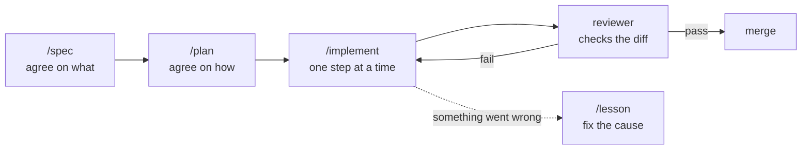

<div align="center">

# agent-kit

**One kit that makes your AI coding agents plan first, follow your rules, and prove their work.**

[](https://github.com/Aiatulla/agent-kit/actions/workflows/verify.yml)


[How it works](#how-it-works) · [How it differs](#how-it-differs) · [Install](#install) · [Use it in a project](#use-it-in-a-project) · [Extend](#extend-the-kit)

</div>

One repo that gives your AI coding agents the same rules, commands, reviewer, hooks, and skills on every machine.
It supports Claude Code and Gemini CLI today, and a new tool is one adapter file.

The kit has three tiers:

- **Global**: stack-free rules, commands (`/spec`, `/plan`, `/implement`, `/lesson`), the reviewer agent, hooks, and skills, installed into each tool on your machine.
- **Stack**: rules, lint presets, and checks for one stack (`nextjs`, `fastapi`), copied into a project by `kit sync`.
- **Project**: everything specific to one project, which lives in that project.

Dependencies: bash (3.2 or newer), git, jq. macOS and Linux.

## How it works

AI agents are fast but tend to guess, skip steps, and "fix" failing tests by changing the tests.
agent-kit gives every task the same path, the way a careful engineering team works:



1. **Spec: agree on what to build.**
   `/spec <idea>` makes the agent interview you one question at a time until the goal is clear.
   It writes `docs/specs/NNN-name.md` with the goal, what is out of scope, and testable acceptance criteria, plus a plain-language summary you can send to a customer.
   No code is written yet.
2. **Plan: agree on how to build it.**
   `/plan docs/specs/NNN-name.md` makes the agent read the code first, then write a plan: the approach, existing code to reuse, files to change, small checkbox steps, the tests, and the risks.
   You read it and approve it before anything changes.
3. **Implement: one small step at a time.**
   `/implement docs/plans/NNN-name.md` does one step, runs the checks, ticks the box, and commits.
   If the plan turns out to be wrong, the agent stops and asks instead of improvising.
4. **Guardrails: run automatically while the agent works.**
   Edits to tests, snapshots, and fixtures are blocked, so the agent has to fix the code, not the test.
   `scripts/verify.sh` runs after every edit and again before the agent may finish.
   After 3 failed checks in a row, the agent must stop and explain instead of trying forever.
5. **Review: a second agent checks the work.**
   The `reviewer` agent did not write the code and assumes it has bugs.
   It checks the diff against the spec and plan: every requirement built and tested, nothing extra added, nothing duplicated, no weakened checks, no security gaps.
   It ends with `VERDICT: PASS` or `VERDICT: FAIL`.
6. **Lesson: learn from mistakes.**
   When something goes wrong, `/lesson` records what happened and why, and proposes the smallest mechanical fix (a lint rule, a test, a hook) so it cannot happen again.

The same rules, commands, and checks apply on every machine and in every tool, so switching between Claude Code and Gemini CLI changes nothing about how the work gets done.

## How it differs

Most agent kits are frameworks for building new agents.
agent-kit is not: it configures the AI coding agents you already use, and keeps them honest.

- **Tool-agnostic**: one source of rules, commands, and skills for Claude Code and Gemini CLI; a new tool is one adapter file.
- **Guardrails that run, not just prompts**: hooks block edits to tests, snapshots, and fixtures, run `scripts/verify.sh` after edits and before the agent stops, and enforce a stop rule after 3 failed checks.
- **Stack-aware**: per-directory stacks (`nextjs`, `fastapi`) bring their own rules, lint presets, and checks, so a monorepo gets the right rules in each folder.
- **Spec-driven workflow**: `/spec`, `/plan`, `/implement`, and `/lesson` commands plus a reviewer agent that checks each diff against its spec and plan.
- **Safe and reversible install**: symlinks into the clone, backups before anything is replaced, merged `settings.json`, idempotent reruns, and a clean `--uninstall`.
- **Committed output**: `kit sync` writes plain files into the project, so teammates and CI need nothing installed.
- **No runtime**: bash, git, and jq only; no Node, Python, or package manager.

## Install

```sh
git clone https://github.com/Aiatulla/agent-kit.git ~/agent-kit
~/agent-kit/install.sh
```

`install.sh` detects Claude Code and Gemini CLI and, for each one, creates one symlink per item into the kit:

- Claude Code: `~/.claude/rules/agent-kit.md` (global rules), `~/.claude/commands/*`, `~/.claude/agents/reviewer.md`, `~/.claude/skills/*`, and the hooks merged into `~/.claude/settings.json`.
- Gemini CLI: `~/.gemini/GEMINI.md`, `~/.gemini/commands/*.toml` (generated from the commands), `~/.gemini/skills/*`.
- `kit` on `~/.local/bin`.

Your own files are never overwritten: anything in the way is moved to `~/.agent-kit-backup/<timestamp>/` first.
`settings.json` is merged, never linked, and running the installer again changes nothing.
Run `./install.sh --dry-run` to see what it would do.

## Update

```sh
cd ~/agent-kit && git pull
```

Links point into the clone, so a pull updates every tool at once.
Run `./install.sh` again only when the pull added new commands, agents, or skills, and `kit sync` in projects to update their stack copies.

## Use it in a project

Create `.agent-kit.json` at the project root, mapping each directory to its stack:

```json
{"stacks": {"frontend": "nextjs", "backend": "fastapi"}}
```

Then run `kit sync` in the project.
It copies the stacks into `.agent-kit/stacks/`, writes each stack's rules into that directory's `AGENTS.md` between `agent-kit` markers (your own content outside the markers is kept), writes `docs/inventory/<stack>.md`, generates `scripts/verify.sh`, installs a pre-commit hook that runs `scripts/verify.sh fast`, and records the kit version.
Commit the result: teammates and CI need nothing else installed.
It prints the one line to add to your ESLint or Ruff config to extend the stack's preset.

The file `.agent-kit.json` also turns on the global hooks for that project:
edits to tests, snapshots, and fixtures are blocked (unless `ALLOW_TEST_EDITS=1`), and `scripts/verify.sh` runs after edits and before the agent stops, with a stop rule after 3 failures.

`kit doctor` checks install links, dependencies, and whether the project is synced with the current kit.
`kit version` prints the kit version.

## Extend the kit

- **A tool**: add `adapters/<tool>.sh` with `<tool>_detect`, `<tool>_install_global`, `<tool>_uninstall_global`, `<tool>_sync_project`, and `<tool>_doctor`.
  Nothing else changes.
- **A stack**: add `stacks/<name>/` with `rules.md` (max 80 lines), `lint/`, `verify.sh` (`fast` and `full`), and `registry.sh`.
  Nothing else changes.
- **A skill**: add `skills/<name>/SKILL.md` whose `name:` matches the folder, then run `./install.sh`.
  Third-party skills go in `vendor/skills/` and are recorded in `vendor/skills-lock.json`.

Run `scripts/verify.sh full` before committing; `AGENTS.md` has the rules for working on this repo.

## Uninstall

```sh
~/agent-kit/install.sh --uninstall
```

This removes only links that point into the kit and the kit's hooks from `settings.json`, then restores your backed-up files.
